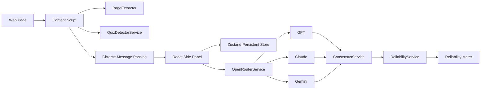
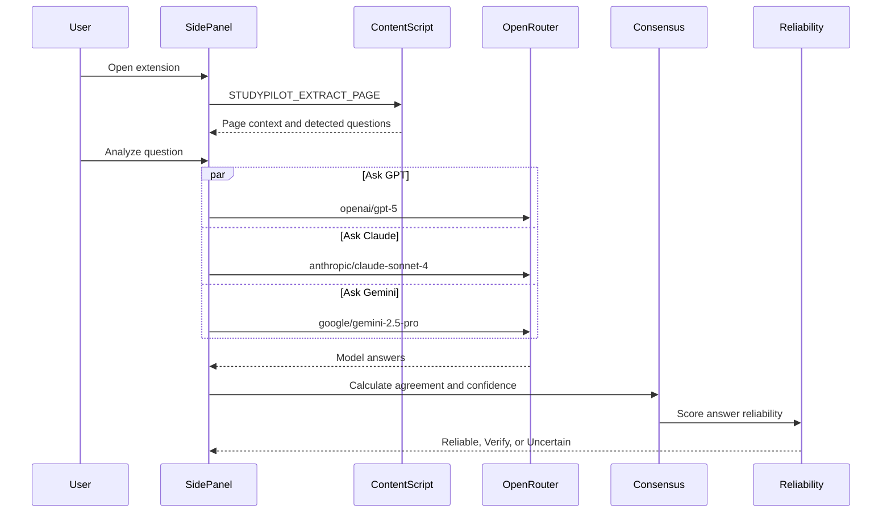

# StudyPilot AI

AI-powered Chrome study assistant featuring automatic quiz detection, multi-model reasoning
(GPT, Claude, Gemini), consensus scoring, confidence estimation, and answer reliability analysis.

## What It Does

StudyPilot AI opens as a Chrome side panel, scans the active webpage for quiz-style questions, asks
multiple OpenRouter-backed models for answers in parallel, and turns the results into a consensus
answer with reliability scoring.

The portfolio-grade differentiators are:

- Automatic MCQ and form-style quiz detection
- Simultaneous GPT, Claude, and Gemini answering through OpenRouter
- Consensus scoring across model answers
- Reliability meter with agreement, confidence, strength, and warning states
- Study helpers for notes, revision points, flashcards, and explanations

## Architecture



## Answer Flow



## Project Structure

```text
src/
  background/
    serviceWorker.ts
  content/
    contentScript.ts
    pageExtractor.ts
  features/
    consensus/
      ConsensusService.ts
      ReliabilityService.ts
    explanation/
      ExplanationService.ts
    flashcards/
      StudyToolsService.ts
    quiz/
      QuizDetectorService.ts
  services/
    models/
      modelCatalog.ts
    openrouter/
      OpenRouterService.ts
  sidepanel/
    App.tsx
    main.tsx
    styles.css
  store/
    useAppStore.ts
  tests/
  types/
  utils/
```

## Setup

Install dependencies:

```bash
npm install
```

Run tests:

```bash
npm test
```

Build the Chrome extension:

```bash
npm run build
```

Load the extension:

1. Open Chrome and go to `chrome://extensions`.
2. Enable Developer mode.
3. Click Load unpacked.
4. Select the generated `dist` folder.
5. Open the side panel from the StudyPilot AI extension icon.

## OpenRouter Configuration

Create an OpenRouter API key and paste it into the StudyPilot AI Settings section. The extension
stores the key in local extension state and sends requests only to `https://openrouter.ai`.

Default models:

- `openai/gpt-5`
- `anthropic/claude-sonnet-4`
- `google/gemini-2.5-pro`

## Testing Coverage

The Vitest suite covers:

- MCQ text parsing
- Radio-button DOM quiz detection
- Consensus agreement and confidence calculations
- Reliability color/status rules
- Parser utility behavior

## Screenshots

Add screenshots here after loading the built extension:

- Side panel scan state
- Detected question list
- Reliability meter
- Model answer comparison
- Settings panel

## Portfolio Description

StudyPilot AI demonstrates a production-minded browser extension architecture with Manifest V3,
Chrome Side Panel API, service worker lifecycle handling, content-script extraction, typed message
passing, modular domain services, persisted client state, schema validation, and focused automated
tests. The key engineering value is the separation between browser-specific adapters and testable
study intelligence services.
